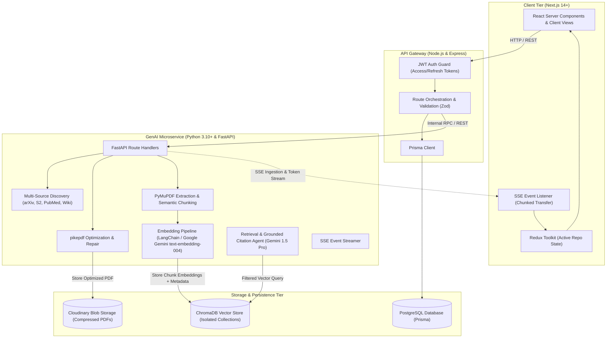
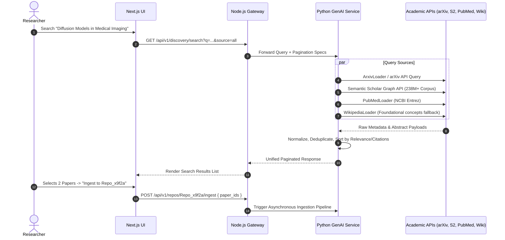
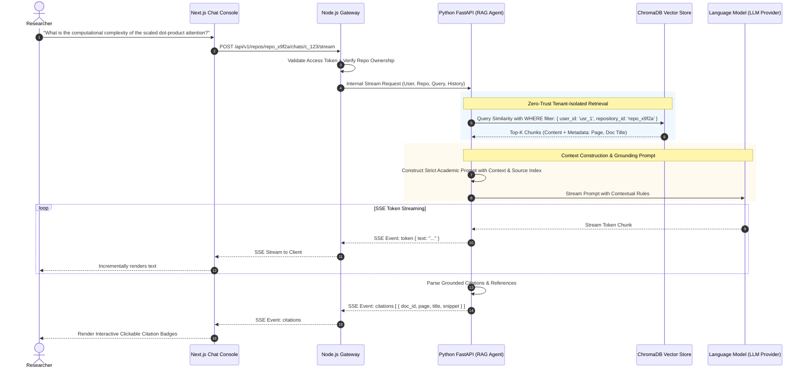
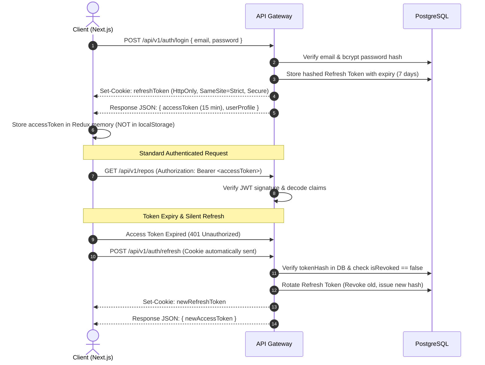
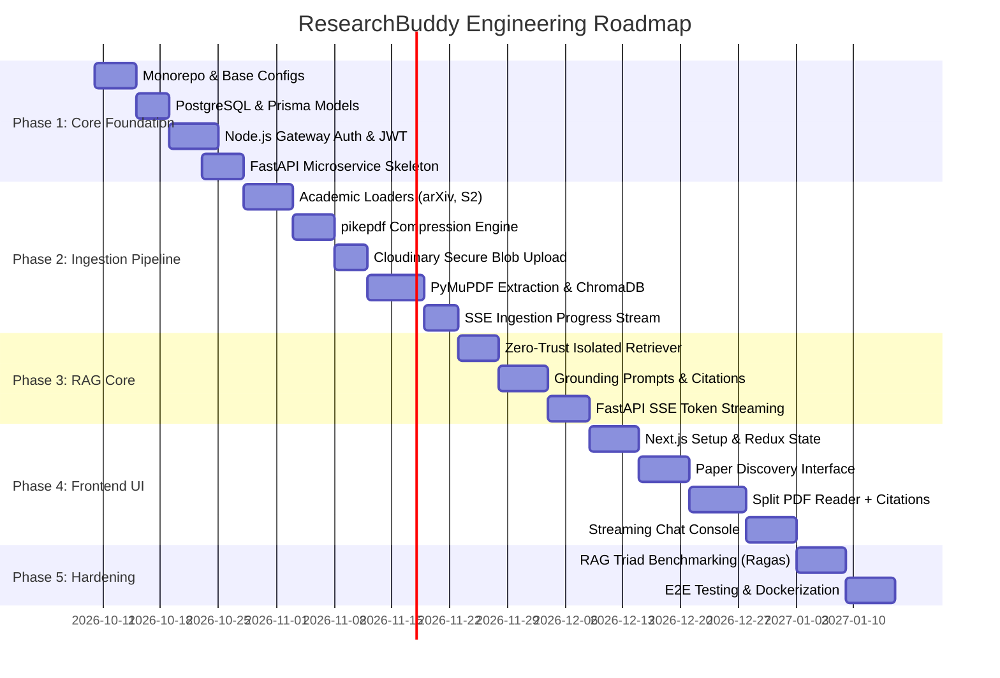

# Research Paper Synthesizer (ResearchBuddy)
## Master System Architecture & Project Planning Specification

*Document Version:* 1.0.0  
*Status:* Approved for Implementation  
*Target Environments:* Development, Staging, Production  
*Primary Author:* Engineering & Architecture Team  

---

## Table of Contents
1. [Executive Summary & System Vision](#1-executive-summary--system-vision)
2. [High-Level Architecture & Microservices Topology](#2-high-level-architecture--microservices-topology)
3. [Multi-Source Document Discovery Pipeline](#3-multi-source-document-discovery-pipeline)
4. [Document Ingestion, Binary Compression & Storage Engine](#4-document-ingestion-binary-compression--storage-engine)
5. [RAG Conversational Engine & Hallucination Mitigation](#5-rag-conversational-engine--hallucination-mitigation)
6. [Data Models & Database Schemas](#6-data-models--database-schemas)
7. [Security Architecture & Multi-Tenant Partitioning](#7-security-architecture--multi-tenant-partitioning)
8. [API Contracts & Event Streaming Protocols](#8-api-contracts--event-streaming-protocols)
9. [Frontend Architecture & State Management](#9-frontend-architecture--state-management)
10. [Phased Implementation Roadmap](#10-phased-implementation-roadmap)
11. [Failure Modes, Edge Cases & Risk Matrix](#11-failure-modes-edge-cases--risk-matrix)

---

## 1. Executive Summary & System Vision

### 1.1 Problem Statement
Modern researchers, software engineers, and university students grapple with literature overload. Academic publications are scattered across disparate databases (arXiv, Semantic Scholar, PubMed, IEEE, ACM), documents are published in dense multi-column PDF formats that are unwieldy on mobile/web viewports, and traditional conversational AI tools suffer from critical drawbacks:
* **Hallucinations & Ungrounded Claims:** Generalized LLMs invent citations, fabricate page numbers, and confuse overlapping methodologies.
* **Lack of Workspace Boundaries:** Ad-hoc chat interfaces mix unrelated papers, corrupting the retrieval context.
* **Storage Inefficiency & Resource Bloat:** Naive storage of multi-megabyte PDFs rapidly escalates object storage costs and degrades indexing latency.

### 1.2 System Vision
**Research Paper Synthesizer (ResearchBuddy)** is an enterprise-grade Retrieval-Augmented Generation (RAG) platform tailored for structured literature exploration, cross-paper synthesis, and verified academic Q&A. The platform enforces a **Zero-Trust Retrieval Model**—guaranteeing that every AI-generated claim is mathematically tethered to verifiable page-level citations in the user's curated repository.

### 1.3 Key Architectural Differentiators
* **Selective Ingestion Paradigm:** Rather than polluting vector databases with bulk web scrapes, users search a unified 230M+ academic paper index and selectively ingest vetted papers into isolated repository workspaces (e.g., `Repo_x9f2a`).
* **Lossless Binary Optimization:** Embedded C++ `qpdf` optimization via `pikepdf` compresses and repairs malformed academic PDFs prior to persistent blob storage.
* **Strict Multi-Tenant Vector Isolation:** ChromaDB queries are programmatically forced to match compound metadata filters (`user_id` and `repository_id`), preventing cross-tenant information leaks.
* **Lightweight Asynchronous Event Streaming:** End-to-end Server-Sent Events (SSE) power real-time ingestion status indicators and low-latency LLM token streaming without the operational overhead of stateful WebSockets.

---

## 2. High-Level Architecture & Microservices Topology

The platform employs a decoupled three-tier microservice architecture to isolate compute-intensive document parsing and neural vector calculations from relational transactional workflows and client rendering.



### 2.1 Service Decomposition & Responsibilities

| Service | Primary Stack | Core Responsibilities |
| :--- | :--- | :--- |
| **Client Interface** | Next.js, React Server Components, Tailwind CSS, Redux Toolkit, Zod | Interactive literature discovery UI, split-view PDF reader, citation drill-downs, reactive chat console, local auth token management. |
| **API Gateway** | Node.js, Express.js, Prisma ORM, TypeScript | User authentication, token issuance/refresh, repository CRUD, document access control, transactional audit logging, upstream routing. |
| **GenAI Microservice** | Python 3.10+, FastAPI, LangChain, pikepdf, PyMuPDF, ChromaDB client | External paper discovery federation, PDF structural compression, text extraction, semantic chunking, vector indexing, citation-grounded RAG streaming. |
| **Relational Database** | PostgreSQL | ACID-compliant persistence of user accounts, refresh token hashes, repository entities, document metadata, and chat message history. |
| **Object Storage** | Cloudinary | Secure cloud-hosted blob repository for compressed research PDFs with signed URLs. |
| **Vector Database** | ChromaDB | Persistent high-dimensional vector embeddings with multi-tenant metadata tagging (`user_id`, `repository_id`, `doc_id`, `page_number`). |

---

## 3. Multi-Source Document Discovery Pipeline

Rather than forcing users to manually download PDFs from fragmented websites and upload them, ResearchBuddy integrates directly with premier academic search indices via unified discovery adapters.



### 3.1 Source Connectors & Integration Details

#### 1. arXiv Connector
* **Library:** `langchain_community.document_loaders.arxiv.ArxivLoader` & arXiv REST API.
* **Domain Focus:** Computer Science, Mathematics, Physics, Quantitative Biology, Electrical Engineering.
* **Capabilities:** Retrieves author lists, primary categories, publication versions, full abstracts, and direct PDF download links (`arxiv.org/pdf/<id>.pdf`).
* **Under-the-hood:** Leverages PyMuPDF internally for swift metadata extraction.

#### 2. Semantic Scholar (S2) Academic Graph
* **Integration:** Semantic Scholar Academic Graph API.
* **Domain Focus:** Cross-disciplinary scientific corpus encompassing 238M+ papers.
* **Capabilities:** Fetches citation counts, influential citation counts, reference lists, open-access PDF URLs (via Unpaywall / S2 Open Access), and Digital Object Identifiers (DOIs).
* **Value:** Enables researchers to judge paper authority immediately through citation metrics.

#### 3. PubMed Connector
* **Library:** `langchain_community.document_loaders.pubmed.PubMedLoader`.
* **Domain Focus:** Biomedical, clinical medicine, life sciences, genomics, and healthcare.
* **Capabilities:** Queries NCBI Entrez utilities, returns MeSH (Medical Subject Headings) terms, structured clinical abstracts, and PubMed Central (PMC) links. Note: Due to NCBI bot-prevention interstitials on direct PMC PDF downloads, PubMed items support abstract discovery and direct user PDF uploads, while arXiv and Semantic Scholar provide direct raw PDF downloads.

#### 4. Wikipedia Connector
* **Library:** `langchain_community.document_loaders.wikipedia.WikipediaLoader`.
* **Domain Focus:** Technical definitions, mathematical theorems, algorithms, historical timelines.
* **Capabilities:** Provides contextual domain knowledge and foundational definitions for dense jargon encountered in specialized papers.

### 3.2 Selective Ingestion Engine
Bulk-scraping entire search results into a RAG vector store causes index dilution, slows retrieval, and pollutes search vectors with tangentially related material. 
ResearchBuddy implements **Selective Ingestion**:
1. The search API returns paginated paper metadata without storing vectors.
2. The user inspects titles, authors, venues, publication dates, and abstracts.
3. The user ticks desired papers and assigns them to an active workspace repository (e.g., `Repo_x9f2a`).
4. Only selected documents trigger the compute-intensive download, compression, chunking, and embedding workflows.

---

## 4. Document Ingestion, Binary Compression & Storage Engine

Academic PDFs are notoriously complex: they feature non-standard font encodings, multi-column typesetting, complex mathematical formulas, embedded vector diagrams, and broken internal cross-reference (`xref`) tables.

```mermaid
flowchart TD
    Start[User Triggers Paper Ingestion] --> InitJob[Init Ingestion Task & Emit SSE: 5%]
    InitJob --> FetchPDF[Fetch PDF from Academic Source / Buffer]
    
    subgraph Compression_Repair ["pikepdf Optimization Phase"]
        FetchPDF --> ParsePike[Parse Document via pikepdf / C++ qpdf]
        ParsePike --> RepairXREF[Repair Malformed XREF & Object Streams]
        RepairXREF --> Linearize[Linearize for Fast Web Viewing]
        Linearize --> StripMeta[Lossless Stream Deflation & Redundant Dict Cleanup]
        StripMeta --> GenOptimized[Generate Optimized PDF Buffer]
    end

    GenOptimized --> EmitSSE_Comp[Emit SSE Progress: 35%]

    subgraph Storage_Upload ["Object Storage Phase"]
        EmitSSE_Comp --> UploadCloudinary[Upload Optimized PDF to Cloudinary]
        UploadCloudinary --> StoreSecureURL[Save Secure Canonical URL & Metadata to PostgreSQL]
    end

    StoreSecureURL --> EmitSSE_Stor[Emit SSE Progress: 50%]

    subgraph Parsing_Chunking ["PyMuPDF & Chunking Phase"]
        EmitSSE_Stor --> PyMuPDFExtract[Extract Page-Aware Structured Text via PyMuPDF]
        PyMuPDFExtract --> SemanticChunk[Semantic Text Splitter with Overlap & Page Tracking]
    end

    SemanticChunk --> EmitSSE_Chunk[Emit SSE Progress: 75%]

    subgraph Vector_Indexing ["Embedding & ChromaDB Phase"]
        EmitSSE_Chunk --> GenEmbeddings[Generate Embeddings via Dense Vector Model]
        GenEmbeddings --> ChromaIndex[Index Chunks in ChromaDB with Strict Metadata Tags]
    end

    ChromaIndex --> UpdateDBStatus[Update Prisma Document Status to 'INDEXED']
    UpdateDBStatus --> EmitSSE_Done[Emit SSE Progress: 100% - Ready for Query]
```



### 4.1 Lossless Compression & Repair with `pikepdf`
Before persistent storage, every ingested PDF undergoes processing by `pikepdf` (leveraging the C++ `qpdf` engine):
* **Structural Efficiency:** Compresses uncompressed object streams using Flate/Deflate algorithms.
* **Automatic Repair:** Automatically reconstructs corrupted cross-reference (`xref`) tables and broken PDF trailers prevalent in legacy academic repositories.
* **Linearization ("Fast Web View"):** Reorganizes the internal PDF structure so that browser PDF viewers can display Page 1 immediately without waiting for the full multi-megabyte binary to download.
* **Lossless Compression:** Reduces binary footprint by 20% to 65% without degrading raster figure resolution or destroying vector font glyphs.

### 4.2 Cloud Object Storage with Cloudinary
* Compressed PDF buffers are streamed directly from FastAPI to Cloudinary using private signed uploads.
* Cloudinary stores the canonical PDF asset under a designated folder path: `research_buddy/users/{user_id}/repos/{repo_id}/{doc_id}.pdf`.
* PostgreSQL stores only the metadata record and Cloudinary `secure_url`. Raw PDF binaries are never persisted in PostgreSQL or the local microservice file system.

### 4.3 Text Parsing via PyMuPDF (`fitz`)
* PyMuPDF parses the PDF text layer with high fidelity, maintaining reading order across multi-column academic layouts.
* Each extracted text unit retains explicit page numbers (`page_number: int`) and bounding block positions, crucial for precise citation generation.

### 4.4 Semantic Chunking & ChromaDB Vector Indexing
* **Chunking Strategy:** `RecursiveCharacterTextSplitter` configured with:
  * Chunk Size: 1,000 characters
  * Chunk Overlap: 200 characters
  * Custom separators preserving academic syntax: `["\n\n## ", "\n\n### ", "\n\n", "\n", ". ", " "]`
* **Metadata Schema per Chunk:**
  ```json
  {
    "user_id": "usr_9981a",
    "repository_id": "repo_x9f2a",
    "document_id": "doc_4102b",
    "document_title": "Attention Is All You Need",
    "page_number": 4,
    "chunk_index": 12
  }
  ```
* **ChromaDB Collection Topology:** Chunks are written into ChromaDB collections indexed using cosine distance / HNSW indexing.

---

## 5. RAG Conversational Engine & Hallucination Mitigation

The primary barrier to adopting AI in scientific workflows is the prevalence of plausible-sounding hallucinations. ResearchBuddy implements a multi-stage **Grounded Verification Loop**.



### 5.1 Zero-Trust Retrieval Filter
When querying ChromaDB, retrieval can **never** execute as a raw semantic similarity query alone. It must supply an immutable boolean filter:
$$\text{Filter} = (\text{user\_id} == \text{current\_user}) \land (\text{repository\_id} == \text{active\_repo})$$
This guarantees mathematical isolation: even if another user's paper is semantically identical, ChromaDB's search space is partitioned away from unauthorized tenants.

### 5.2 Context Formatting & Grounding Prompt Template
Retrieved chunks are formatted with explicit bracketed keys before injection into the prompt context:

```text
SYSTEM INSTRUCTION:
You are an expert academic research assistant operating strictly on verified source documents provided below.
Your role is to synthesize accurate, insightful, and comprehensive answers to the user's research queries.

MANDATORY RULES:
1. Grounding Rule: Answer the question ONLY using the factual context provided in the "SOURCE DOCUMENTS" block.
2. Citation Rule: For every factual claim, equation, or methodology you state, immediately append a citation tag in the exact format: [Doc: <Title>, Page: <PageNum>].
3. Hallucination Prohibition: If the provided source documents do not contain sufficient evidence to answer the question, state: "The documents in this repository do not contain sufficient evidence to answer this question." Do NOT extrapolate or speculate.
4. No Blind Assumptions: If authors contrast two methods, cite both corresponding pages.

SOURCE DOCUMENTS:
---
[SOURCE 1]
Document: Attention Is All You Need
Page: 4
Content:
"The two most commonly used attention functions are additive attention and dot-product attention... Dot-product attention is much faster and more space-efficient in practice, since it can be implemented using highly optimized matrix multiplication code."
---
[SOURCE 2]
Document: Attention Is All You Need
Page: 5
Content:
"Scaled dot-product attention computes the attention weights as softmax(QK^T / sqrt(d_k))V..."
---

USER QUESTION:
{user_query}
```

### 5.3 Interactive Citation Resolution
When the LLM streams its response, citations like `[Doc: Attention Is All You Need, Page: 4]` are detected by the client UI. The frontend transforms these text markers into interactive badge chips. Clicking a chip:
1. Opens the built-in PDF viewer split-pane.
2. Navigates directly to the specified page number.
3. Highlights the corresponding source sentence for immediate auditability.

---

## 6. Data Models & Database Schemas

### 6.1 PostgreSQL Schema (Prisma ORM)

```prisma
datasource db {
  provider = "postgresql"
  url      = env("DATABASE_URL")
}

generator client {
  provider = "prisma-client-js"
}

enum DocumentSource {
  ARXIV
  SEMANTIC_SCHOLAR
  PUBMED
  WIKIPEDIA
  MANUAL_UPLOAD
}

enum IngestionStatus {
  PENDING
  PROCESSING
  INDEXED
  FAILED
}

enum MessageRole {
  USER
  ASSISTANT
  SYSTEM
}

model User {
  id            String         @id @default(uuid())
  email         String         @unique
  passwordHash  String
  name          String
  createdAt     DateTime       @default(now())
  updatedAt     DateTime       @updatedAt

  repositories  Repository[]
  refreshTokens RefreshToken[]

  @@map("users")
}

model RefreshToken {
  id          String   @id @default(uuid())
  tokenHash   String   @unique
  userId      String
  user        User     @relation(fields: [userId], references: [id], onDelete: Cascade)
  isRevoked   Boolean  @default(false)
  expiresAt   DateTime
  createdAt   DateTime @default(now())

  @@index([userId])
  @@map("refresh_tokens")
}

model Repository {
  id          String       @id @default(uuid())
  name        String
  description String?
  colorTag    String       @default("#3B82F6")
  userId      String
  user        User         @relation(fields: [userId], references: [id], onDelete: Cascade)
  createdAt   DateTime     @default(now())
  updatedAt   DateTime     @updatedAt

  documents     Document[]
  conversations Conversation[]

  @@index([userId])
  @@map("repositories")
}

model Document {
  id                 String          @id @default(uuid())
  repositoryId       String
  repository         Repository      @relation(fields: [repositoryId], references: [id], onDelete: Cascade)
  title              String
  authors            String[]
  abstract           String?         @db.Text
  source             DocumentSource
  externalId         String?         // arXiv ID, DOI, or PubMed ID
  cloudinaryUrl      String?
  cloudinaryPublicId String?
  fileSizeBytesRaw   Int?
  fileSizeBytesComp  Int?
  pageCount          Int?
  status             IngestionStatus @default(PENDING)
  errorMessage       String?
  createdAt          DateTime        @default(now())
  updatedAt          DateTime        @updatedAt

  @@index([repositoryId])
  @@index([externalId])
  @@map("documents")
}

model Conversation {
  id           String        @id @default(uuid())
  repositoryId String
  repository   Repository    @relation(fields: [repositoryId], references: [id], onDelete: Cascade)
  title        String        @default("New Literature Discussion")
  createdAt    DateTime      @default(now())
  updatedAt    DateTime      @updatedAt

  messages     ChatMessage[]

  @@index([repositoryId])
  @@map("conversations")
}

model ChatMessage {
  id             String       @id @default(uuid())
  conversationId String
  conversation   Conversation @relation(fields: [conversationId], references: [id], onDelete: Cascade)
  role           MessageRole
  content        String       @db.Text
  citations      Json?        // Structured citation references: [{ docId, title, page, snippet }]
  tokenCount     Int?
  createdAt      DateTime     @default(now())

  @@index([conversationId])
  @@map("chat_messages")
}
```

### 6.2 ChromaDB Metadata Schema
Each chunk stored in the ChromaDB collection `research_paper_embeddings` carries the following strict scalar metadata keys:

| Field Name | Type | Purpose | Filterable |
| :--- | :--- | :--- | :--- |
| `user_id` | `string` | Owner of the repository | **Yes (Strict Equality)** |
| `repository_id` | `string` | Target workspace isolate | **Yes (Strict Equality)** |
| `document_id` | `string` | Foreign key to PostgreSQL `Document.id` | **Yes** |
| `document_title` | `string` | For rapid context formatting | No |
| `page_number` | `int` | Physical PDF page anchor | **Yes (Range/Equality)** |
| `chunk_index` | `int` | Sequential chunk index within the document | No |

---

## 7. Security Architecture & Multi-Tenant Partitioning

### 7.1 Two-Token Stateless JWT Authentication
To strike an optimal balance between security and low-latency API verification, ResearchBuddy enforces a dual-token lifecycle:



#### Security Guardrails
1. **Access Token:** Short lifespan (15 minutes), signed using HMAC-SHA256 or RSA-256. Stored in client memory (Redux state). It is **never** written to `localStorage` or `sessionStorage` to mitigate Cross-Site Scripting (XSS) extraction attacks.
2. **Refresh Token:** Long lifespan (7 days). Stored in an `HttpOnly`, `SameSite=Strict`, `Secure` browser cookie. Inaccessible to client JavaScript.
3. **Refresh Token Rotation (RTR):** Each refresh request invalidates the utilized refresh token and issues a new pair. If a revoked token is reused, the entire token family is immediately purged, flagging a potential token theft event.

### 7.2 Zero-Trust Vector Isolation
Multi-tenant vector databases are prone to critical data leakage if vector filtering is treated as an optional parameter.
* **Gateway Level:** Before any query reaches FastAPI, the Node.js API Gateway verifies that `repository_id` belongs to `req.user.id`.
* **Microservice Level:** The Python service extracts `user_id` and `repository_id` from the signed internal token payload and injects them directly into ChromaDB's retrieval clause:
  ```python
  results = collection.query(
      query_texts=[sanitized_query],
      n_results=top_k,
      where={
          "$and": [
              {"user_id": {"$eq": authenticated_user_id}},
              {"repository_id": {"$eq": active_repository_id}}
          ]
      }
  )
  ```
* Cross-repository or cross-user query contamination is structurally blocked at the vector engine index level.

---

## 8. API Contracts & Event Streaming Protocols

### 8.1 API Gateway REST Routes (Node.js / Express)

#### Authentication (`/api/v1/auth`)
* `POST /register`: Create user account (`email`, `password`, `name`).
* `POST /login`: Authenticate credentials, set HttpOnly refresh cookie, return access token.
* `POST /refresh`: Verify refresh cookie, rotate token, return new access token.
* `POST /logout`: Revoke active refresh token, clear cookie.
* `GET  /me`: Return current authenticated profile.

#### Workspaces / Repositories (`/api/v1/repos`)
* `GET    /`: List all repositories owned by the user.
* `POST   /`: Create a new repository (`name`, `description`, `colorTag`).
* `GET    /:id`: Fetch repository details, attached documents count, and recent chats.
* `PATCH  /:id`: Update repository metadata.
* `DELETE /:id`: Cascade delete repository, related documents, ChromaDB vectors, and chat history.

#### Document Discovery & Ingestion (`/api/v1/repos/:id/documents`)
* `GET  /discovery/search`: Unified query endpoint (`query`, `sources`, `limit`, `page`).
* `POST /ingest`: Trigger ingestion of selected papers (`paper_ids`, `source_type`).
* `GET  /ingest/:jobId/stream`: SSE connection streaming ingestion progress (proxy to FastAPI).
* `GET  /`: List all ingested documents within the repository.
* `DELETE /:docId`: Remove document from repository and delete associated vector chunks.

#### Conversational Workspace (`/api/v1/repos/:id/chats`)
* `GET  /`: List conversations for the active repository.
* `POST /`: Initialize a new conversation thread.
* `GET  /:chatId/messages`: Fetch historical messages for the conversation.
* `POST /:chatId/stream`: Initiate SSE-grounded answer generation stream.

---

### 8.2 Server-Sent Events (SSE) Streaming Contracts

#### 1. Ingestion Progress Stream (`text/event-stream`)
During paper ingestion, FastAPI yields fine-grained progress updates:

```text
event: progress
data: {"jobId": "job_991a", "step": "FETCHING_PDF", "percent": 15, "message": "Downloading raw PDF binary from arXiv..."}

event: progress
data: {"jobId": "job_991a", "step": "PIKEPDF_OPTIMIZATION", "percent": 35, "message": "Compressing object streams and repairing xref tables via pikepdf..."}

event: progress
data: {"jobId": "job_991a", "step": "CLOUDINARY_UPLOAD", "percent": 55, "message": "Securing compressed PDF asset in cloud blob storage..."}

event: progress
data: {"jobId": "job_991a", "step": "VECTOR_EMBEDDING", "percent": 80, "message": "Extracting text with PyMuPDF and indexing semantic chunks in ChromaDB..."}

event: complete
data: {"jobId": "job_991a", "percent": 100, "documentId": "doc_4102b", "status": "INDEXED"}
```

#### 2. RAG LLM Token Generation Stream (`text/event-stream`)
During chat sessions, FastAPI streams LLM tokens followed by verified citation metadata:

```text
event: token
data: {"token": "Scaled "}

event: token
data: {"token": "dot-product "}

event: token
data: {"token": "attention "}

event: citations
data: {
  "citations": [
    {
      "citationId": "cite_1",
      "docId": "doc_4102b",
      "docTitle": "Attention Is All You Need",
      "pageNumber": 4,
      "snippet": "Dot-product attention is much faster and more space-efficient in practice..."
    }
  ]
}

event: done
data: {"finishReason": "stop", "totalTokens": 248}
```

---

## 9. Frontend Architecture & State Management

### 9.1 Component Hierarchy & Layout

```text
src/
├── app/
│   ├── (auth)/
│   │   ├── login/page.tsx
│   │   └── register/page.tsx
│   ├── dashboard/
│   │   ├── layout.tsx                # Sidebar, User Avatar, Repo Switcher
│   │   ├── page.tsx                  # Workspace list & quick actions
│   │   └── repo/[repoId]/
│   │       ├── page.tsx              # Repository unified workspace
│   │       ├── discovery/page.tsx    # Multi-source paper search modal
│   │       └── reader/[docId]/page.tsx# Focused PDF viewer
├── components/
│   ├── discovery/
│   │   ├── SearchInputBar.tsx
│   │   ├── PaperResultCard.tsx
│   │   ├── SourceFilterPill.tsx
│   │   └── IngestionProgressModal.tsx
│   ├── chat/
│   │   ├── ChatContainer.tsx
│   │   ├── MessageList.tsx
│   │   ├── StreamingBubble.tsx
│   │   ├── CitationBadge.tsx
│   │   └── QueryPromptInput.tsx
│   ├── reader/
│   │   ├── SplitViewPane.tsx
│   │   ├── PDFViewerCanvas.tsx       # Powered by react-pdf / PDF.js
│   │   └── PageJumpController.tsx
│   └── ui/                           # Atoms & Molecules (Buttons, Inputs, Modals)
├── store/
│   ├── index.ts                      # Redux Toolkit Store
│   ├── slices/
│   │   ├── authSlice.ts              # User profile & memory accessToken
│   │   ├── repositorySlice.ts        # Active workspace & repo lists
│   │   ├── documentSlice.ts          # Repository documents & ingestion queue
│   │   └── chatSlice.ts              # Active conversation, message stream & active citations
└── lib/
    ├── api/                          # Axios / Fetch client wrappers with interceptors
    ├── sse/                          # EventSource & chunked fetch consumers
    └── validation/                   # Zod schemas matching API contracts
```

### 9.2 Redux Toolkit State Slice Model

```mermaid
graph TD
    Store[Redux Root Store]
    
    subgraph AuthSlice
        A1[accessToken: string | null]
        A2[user: UserProfile | null]
        A3[isAuthenticated: boolean]
    end

    subgraph RepositorySlice
        R1[activeRepositoryId: string | null]
        R2[repositories: Repository[]]
        R3[isLoadingRepos: boolean]
    end

    subgraph DocumentSlice
        D1[documents: Document[]]
        D2[ingestionJobs: Record<JobId, ProgressPayload>]
        D3[selectedDocForReading: string | null]
    end

    subgraph ChatSlice
        C1[activeConversationId: string | null]
        C2[messages: ChatMessage[]]
        C3[isStreaming: boolean]
        C4[currentStreamContent: string]
        C5[activeCitations: Citation[]]
    end

    Store --> AuthSlice
    Store --> RepositorySlice
    Store --> DocumentSlice
    Store --> ChatSlice
```

---

## 10. Phased Implementation Roadmap



### Detailed Phase Breakdown

#### Phase 1: Core Foundation & Infrastructure
* Initialize project directory structure (`gateway/`, `ai-service/`, `web/`, `docs/`).
* Configure PostgreSQL with Prisma ORM; run migrations for users, repositories, documents, and chat messages.
* Implement dual-token authentication in Node.js (Access Token in response, Refresh Token in HttpOnly cookie).
* Build FastAPI skeleton with health checks and CORS configuration.

#### Phase 2: Document Discovery, Compression & Vector Ingestion
* Integrate `ArxivLoader`, Semantic Scholar API, `PubMedLoader`, and `WikipediaLoader` in FastAPI.
* Construct the selective discovery endpoint with search aggregation, normalization, and pagination.
* Implement the `pikepdf` compression pipeline: linearizing streams, repairing malformed xrefs, and deflating binaries.
* Set up Cloudinary blob upload integration with signed URLs.
* Parse text using PyMuPDF (`fitz`), generate chunks with `RecursiveCharacterTextSplitter`, and index into ChromaDB with tenant metadata (`user_id`, `repository_id`).
* Expose SSE progress streaming for ingestion tasks.

#### Phase 3: RAG Engine & Conversational Streaming
* Implement the ChromaDB zero-trust retrieval chain with compound metadata filtering.
* Design and benchmark grounding prompts enforcing explicit citation format `[Doc: <Title>, Page: <PageNum>]`.
* Configure FastAPI streaming response with chunked transfer encoding emitting real-time token events and parsed citation payloads.

#### Phase 4: Next.js Client Interface & Ergonomics
* Set up Next.js App Router with Tailwind CSS and Redux Toolkit store.
* Build the Paper Discovery Modal with search filters (source pills, date range, citation sorting).
* Build the split-pane workspace layout:
  * Left pane: PDF viewer (`react-pdf`) with direct page navigation.
  * Right pane: Real-time conversational AI chat.
* Connect SSE listeners to display live ingestion bars and typewriter token streams.
* Implement clickable citation badges that anchor directly to the referenced PDF page.

#### Phase 5: Hardening, Evaluation & Production Deployment
* Benchmark retrieval accuracy and hallucination rates using RAG Triad metrics (Context Relevance, Groundedness, Answer Relevance).
* Add Dockerfiles and `docker-compose.yml` for unified local development (PostgreSQL, ChromaDB, FastAPI, Node.js Gateway).
* Implement rate limiting, input sanitization via Zod, and security headers.

---

## 11. Failure Modes, Edge Cases & Risk Matrix

| Risk / Edge Case | Impact | Likelihood | Mitigation Strategy |
| :--- | :--- | :--- | :--- |
| **Malformed or Encrypted Academic PDFs** | Ingestion pipeline crashes or hangs | Medium | Use `pikepdf` in a `try/except` block to detect password-locked files and automatically repair corrupted xref tables. Fall back to raw PyMuPDF if optimization fails. |
| **External Academic API Rate Limits (e.g., Semantic Scholar)** | Discovery queries return 429 errors | Medium | Implement server-side Redis caching for search queries with 6-hour TTLs; add exponential backoff retry wrappers (`tenacity` in Python). |
| **Cross-Tenant Vector Bleed** | Critical security violation; user sees another user's paper data | Low | Enforce double-layer validation: Gateway checks repository ownership in PostgreSQL before invocation; FastAPI strictly mandates `$and: [{user_id}, {repository_id}]` in all ChromaDB queries. |
| **Silent Token Expiration during Long SSE Streams** | Stream aborts mid-generation | Low | Gateway validates access token upon SSE connection handshake; once established, the HTTP chunked stream remains open until generation completes. |
| **Non-Searchable / Scanned PDFs** | Text extraction returns empty strings | Low | Detect empty text returns from PyMuPDF (< 50 characters across 3 pages) and flag document status as `FAILED_OCR_REQUIRED` (Phase 2 enhancement: trigger Tesseract OCR worker). |
| **ChromaDB Cold Start & Memory Spikes** | Latency degradation on heavy embedding indexing | Medium | Run ChromaDB in persistent client mode with persistent volume storage; throttle concurrent ingestion workers using Celery / Redis queue in high-load scenarios. |

---

## 12. Conclusion & Next Steps
This project overview establishes the architectural foundation for ResearchBuddy. Development will proceed sequentially following the [Phased Implementation Roadmap](#10-phased-implementation-roadmap), starting with Phase 1 infrastructure setup, schema definitions, and authentication guards.
