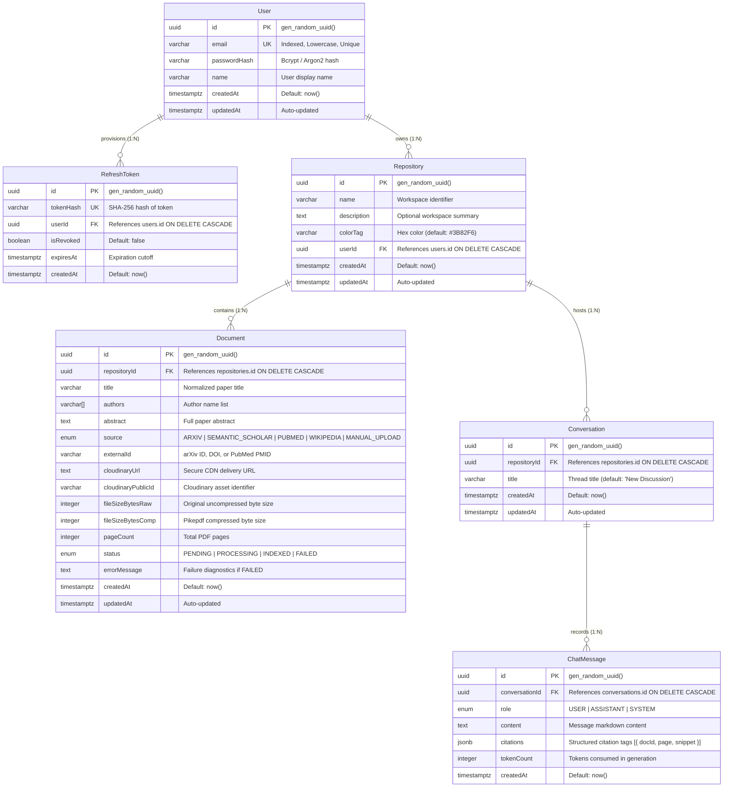
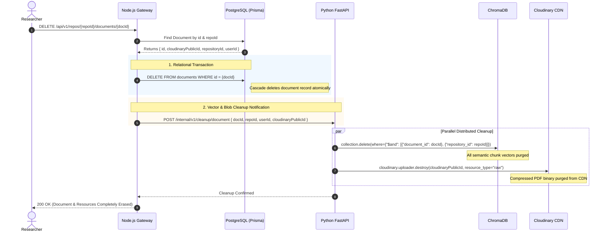

# Research Paper Synthesizer (ResearchBuddy)
## Database Schema, Entity-Relationship Diagram (ERD) & Storage Specification

*Document Identifier:* `DATA-SPEC-002`  
*Version:* `1.0.0`  
*Status:* Approved for Implementation  
*Target Engines:* PostgreSQL 15+ (Relational), ChromaDB (Vector), Cloudinary (Blob)  
*ORM:* Prisma 5+ (TypeScript)  
*Scope:* Relational Schema, Vector Metadata Models, Blob Key Taxonomies, Indexes, Migrations, and Integrity Hooks  

---

## Table of Contents
1. [Storage Architecture & Design Principles](#1-storage-architecture--design-principles)
2. [Complete Entity-Relationship Diagram (ERD)](#2-complete-entity-relationship-diagram-erd)
3. [Comprehensive Data Dictionary & Entity Specifications](#3-comprehensive-data-dictionary--entity-specifications)
4. [Production Prisma Schema Definition](#4-production-prisma-schema-definition)
5. [Raw PostgreSQL DDL Migration Specification](#5-raw-postgresql-ddl-migration-specification)
6. [Indexing Strategy & Query Optimization](#6-indexing-strategy--query-optimization)
7. [ChromaDB Vector Metadata Schema & Collection Topology](#7-chromadb-vector-metadata-schema--collection-topology)
8. [Cloudinary Blob Taxonomy & URL Lifecycle](#8-cloudinary-blob-taxonomy--url-lifecycle)
9. [Cascading Deletions & Cross-Storage Integrity Protocol](#9-cascading-deletions--cross-storage-integrity-protocol)
10. [Sample Records & JSONB Citation Schema](#10-sample-records--jsonb-citation-schema)
11. [Database Migration & Maintenance Procedures](#11-database-migration--maintenance-procedures)

---

## 1. Storage Architecture & Design Principles

ResearchBuddy adopts a **Hybrid Partitioned Storage Architecture** designed to balance transactional rigor, high-dimensional vector search, and cost-effective binary file hosting.

```
┌──────────────────────────────────────────────────────────────────────────────────┐
│                         HYBRID STORAGE TRIAD ARCHITECTURE                        │
├───────────────────────────┬──────────────────────────┬───────────────────────────┤
│    RELATIONAL TIER        │       VECTOR TIER        │        BLOB TIER          │
│     (PostgreSQL 15+)      │       (ChromaDB)         │       (Cloudinary)        │
├───────────────────────────┼──────────────────────────┼───────────────────────────┤
│ • User credentials & auth │ • Dense chunk embeddings │ • Compressed PDF binaries │
│ • Workspace Repositories  │ • Page-level vectors     │ • Linearized web streams  │
│ • Document metadata       │ • Tenant filter tags     │ • Canonical CDN URLs      │
│ • Chat message histories  │   (user_id, repo_id)     │ • Signed access tokens    │
│ • JSONB citation anchors  │ • Cosine HNSW index      │                           │
└───────────────────────────┴──────────────────────────┴───────────────────────────┘
```

### 1.1 Core Relational Design Principles
1. **Surrogate UUID Primary Keys:** All primary keys use RFC 4122 v4 UUIDs generated via `gen_random_uuid()` or `cuid()`. This prevents enumeration attacks and facilitates distributed ID generation without database round-trips.
2. **Explicit Foreign Key Constraints with Cascading:** Child entities (`RefreshToken`, `Repository`, `Document`, `Conversation`, `ChatMessage`) enforce strict `ON DELETE CASCADE` constraints to prevent orphan rows.
3. **Auditability & Temporal Tracking:** Every primary domain table incorporates immutable `createdAt` timestamps and auto-updated `updatedAt` timestamps.
4. **Relational vs. Vector Separation:** PostgreSQL never stores raw document text chunks or floating-point vector arrays. Text chunks and embeddings reside exclusively in ChromaDB, connected to PostgreSQL via the foreign key `Document.id`.
5. **Structured Semi-Structured Data (JSONB):** Complex, dynamic citation metadata emitted by the RAG engine is stored in native PostgreSQL `JSONB` columns, enabling rich querying without proliferating complex join tables for citation fragments.

---

## 2. Complete Entity-Relationship Diagram (ERD)

The following Mermaid diagram visualizes the relational schema, cardinatlities, foreign key connections, and column constraints.



---

## 3. Comprehensive Data Dictionary & Entity Specifications

### 3.1 Entity: `User` (`users`)
Stores authenticated user accounts.

| Attribute | DB Column | Data Type | Nullable | Default | Constraints / Flags | Description |
| :--- | :--- | :--- | :--- | :--- | :--- | :--- |
| `id` | `id` | `UUID` | No | `gen_random_uuid()` | **PK** | Unique identifier for the user. |
| `email` | `email` | `VARCHAR(255)` | No | None | **UK**, Indexed, Lowercase | User email address used for login. |
| `passwordHash`| `password_hash` | `VARCHAR(255)` | No | None | None | Bcrypt-hashed password (salt rounds $\ge 12$). |
| `name` | `name` | `VARCHAR(150)` | No | None | None | Full display name of the user. |
| `createdAt` | `created_at` | `TIMESTAMPTZ` | No | `NOW()` | None | Account creation timestamp. |
| `updatedAt` | `updated_at` | `TIMESTAMPTZ` | No | `NOW()` | Auto-updated | Last profile modification timestamp. |

*Indexes:*
* `users_email_key`: Unique B-Tree index on `LOWER(email)`.

---

### 3.2 Entity: `RefreshToken` (`refresh_tokens`)
Stores cryptographically hashed refresh tokens used in the Refresh Token Rotation (RTR) flow.

| Attribute | DB Column | Data Type | Nullable | Default | Constraints / Flags | Description |
| :--- | :--- | :--- | :--- | :--- | :--- | :--- |
| `id` | `id` | `UUID` | No | `gen_random_uuid()` | **PK** | Unique identifier of the token record. |
| `tokenHash` | `token_hash` | `VARCHAR(64)` | No | None | **UK**, Indexed | SHA-256 hash of the issued refresh token. |
| `userId` | `user_id` | `UUID` | No | None | **FK** (`users.id`), `ON DELETE CASCADE` | Associated user identity. |
| `isRevoked` | `is_revoked` | `BOOLEAN` | No | `false` | None | Revocation flag for logout or token reuse. |
| `expiresAt` | `expires_at` | `TIMESTAMPTZ` | No | None | Indexed | Exact expiry timestamp (typically 7 days). |
| `createdAt` | `created_at` | `TIMESTAMPTZ` | No | `NOW()` | None | Token issuance timestamp. |

*Indexes:*
* `refresh_tokens_token_hash_key`: Unique B-Tree index on `token_hash`.
* `refresh_tokens_user_id_idx`: B-Tree index on `user_id` for fast user-session revocation.
* `refresh_tokens_expires_at_idx`: B-Tree index on `expires_at` for background cron cleanup.

---

### 3.3 Entity: `Repository` (`repositories`)
Represents an isolated literature workspace (e.g. "Diffusion Models Survey", "LLM Quantization"). Serves as the primary multi-tenant boundary for documents, vector collections, and conversations.

| Attribute | DB Column | Data Type | Nullable | Default | Constraints / Flags | Description |
| :--- | :--- | :--- | :--- | :--- | :--- | :--- |
| `id` | `id` | `UUID` | No | `gen_random_uuid()` | **PK** | Unique identifier for the repository. |
| `name` | `name` | `VARCHAR(120)` | No | None | None | Display title of the research workspace. |
| `description`| `description` | `TEXT` | Yes | `NULL` | None | Optional description of the research goal. |
| `colorTag` | `color_tag` | `VARCHAR(16)` | No | `'#3B82F6'` | None | Hex color string for UI badge rendering. |
| `userId` | `user_id` | `UUID` | No | None | **FK** (`users.id`), `ON DELETE CASCADE` | Owner user ID. |
| `createdAt` | `created_at` | `TIMESTAMPTZ` | No | `NOW()` | None | Creation timestamp. |
| `updatedAt` | `updated_at` | `TIMESTAMPTZ` | No | `NOW()` | Auto-updated | Last workspace update timestamp. |

*Indexes:*
* `repositories_user_id_idx`: B-Tree index on `user_id` to accelerate listing user workspaces.
* `repositories_user_id_created_at_idx`: Composite B-Tree index on `(user_id, created_at DESC)`.

---

### 3.4 Entity: `Document` (`documents`)
Represents a vetted academic paper selectively ingested into a repository.

| Attribute | DB Column | Data Type | Nullable | Default | Constraints / Flags | Description |
| :--- | :--- | :--- | :--- | :--- | :--- | :--- |
| `id` | `id` | `UUID` | No | `gen_random_uuid()` | **PK** | Unique identifier for the document. |
| `repositoryId` | `repository_id` | `UUID` | No | None | **FK** (`repositories.id`), `ON DELETE CASCADE` | Workspace repository container. |
| `title` | `title` | `VARCHAR(500)` | No | None | Indexed | Normalized academic paper title. |
| `authors` | `authors` | `TEXT[]` | No | `'{}'` | None | Array of contributing author names. |
| `abstract` | `abstract` | `TEXT` | Yes | `NULL` | None | Full academic paper abstract. |
| `source` | `source` | `ENUM` | No | None | None | Source catalog (`ARXIV`, `SEMANTIC_SCHOLAR`, `PUBMED`, `WIKIPEDIA`, `MANUAL_UPLOAD`). |
| `externalId` | `external_id` | `VARCHAR(100)` | Yes | `NULL` | Indexed | External identifier (e.g. `2312.00752`, `10.1145/3290605`). |
| `cloudinaryUrl` | `cloudinary_url` | `TEXT` | Yes | `NULL` | None | HTTPS delivery URL for compressed PDF. |
| `cloudinaryPublicId` | `cloudinary_public_id` | `VARCHAR(255)` | Yes | `NULL` | None | Cloudinary asset public ID for asset deletion. |
| `fileSizeBytesRaw` | `file_size_bytes_raw` | `INTEGER` | Yes | `NULL` | None | Size in bytes before `pikepdf` compression. |
| `fileSizeBytesComp` | `file_size_bytes_comp`| `INTEGER` | Yes | `NULL` | None | Size in bytes after `pikepdf` compression. |
| `pageCount` | `page_count` | `INTEGER` | Yes | `NULL` | None | Total parsed pages in PDF. |
| `status` | `status` | `ENUM` | No | `'PENDING'` | Indexed | Pipeline state: `PENDING`, `PROCESSING`, `INDEXED`, `FAILED`. |
| `errorMessage`| `error_message` | `TEXT` | Yes | `NULL` | None | Detailed error log if status is `FAILED`. |
| `createdAt` | `created_at` | `TIMESTAMPTZ` | No | `NOW()` | None | Document record creation timestamp. |
| `updatedAt` | `updated_at` | `TIMESTAMPTZ` | No | `NOW()` | Auto-updated | Status change or update timestamp. |

*Indexes:*
* `documents_repository_id_idx`: B-Tree index on `repository_id` for retrieving workspace documents.
* `documents_repository_id_status_idx`: Composite index on `(repository_id, status)` for polling and list filtering.
* `documents_external_id_idx`: B-Tree index on `external_id` to prevent duplicate ingestion in the same workspace.

---

### 3.5 Entity: `Conversation` (`conversations`)
Represents an isolated chat session within a repository workspace.

| Attribute | DB Column | Data Type | Nullable | Default | Constraints / Flags | Description |
| :--- | :--- | :--- | :--- | :--- | :--- | :--- |
| `id` | `id` | `UUID` | No | `gen_random_uuid()` | **PK** | Unique identifier of the conversation thread. |
| `repositoryId` | `repository_id` | `UUID` | No | None | **FK** (`repositories.id`), `ON DELETE CASCADE` | Associated workspace repository. |
| `title` | `title` | `VARCHAR(200)` | No | `'New Discussion'`| None | Thread title (derived from first prompt). |
| `createdAt` | `created_at` | `TIMESTAMPTZ` | No | `NOW()` | None | Conversation start timestamp. |
| `updatedAt` | `updated_at` | `TIMESTAMPTZ` | No | `NOW()` | Auto-updated | Timestamp of last posted message. |

*Indexes:*
* `conversations_repository_id_idx`: B-Tree index on `repository_id`.
* `conversations_repository_id_updated_at_idx`: Composite index on `(repository_id, updated_at DESC)`.

---

### 3.6 Entity: `ChatMessage` (`chat_messages`)
Stores individual turns within a conversation, capturing user prompts, assistant answers, grounded citation tags, and token consumption.

| Attribute | DB Column | Data Type | Nullable | Default | Constraints / Flags | Description |
| :--- | :--- | :--- | :--- | :--- | :--- | :--- |
| `id` | `id` | `UUID` | No | `gen_random_uuid()` | **PK** | Unique message ID. |
| `conversationId` | `conversation_id` | `UUID` | No | None | **FK** (`conversations.id`), `ON DELETE CASCADE` | Parent conversation thread. |
| `role` | `role` | `ENUM ('USER', 'ASSISTANT', 'SYSTEM')` | No | None | None | Author role of the message. |
| `content` | `content` | `TEXT` | No | None | None | Markdown content of the message. |
| `citations` | `citations` | `JSONB` | Yes | `NULL` | Indexed (GIN) | Array of grounded citation objects. |
| `tokenCount` | `token_count` | `INTEGER` | Yes | `NULL` | None | Total tokens consumed for this turn. |
| `createdAt` | `created_at` | `TIMESTAMPTZ` | No | `NOW()` | Indexed | Message emission timestamp. |

*Indexes:*
* `chat_messages_conversation_id_created_at_idx`: Composite B-Tree on `(conversation_id, created_at ASC)` for chronological chat loading.
* `chat_messages_citations_gin_idx`: PostgreSQL GIN index on `citations` for JSONB path querying.

---

## 4. Production Prisma Schema Definition

Below is the complete, validated `schema.prisma` configuration file to be located at `gateway/prisma/schema.prisma`:

```prisma
// ============================================================================
// ResearchBuddy - Enterprise Relational Schema (Prisma 5+)
// File: gateway/prisma/schema.prisma
// ============================================================================

datasource db {
  provider = "postgresql"
  url      = env("DATABASE_URL")
}

generator client {
  provider        = "prisma-client-js"
  previewFeatures = ["relationJoins"]
}

// ----------------------------------------------------------------------------
// ENUMS
// ----------------------------------------------------------------------------

enum DocumentSource {
  ARXIV
  SEMANTIC_SCHOLAR
  PUBMED
  WIKIPEDIA
  MANUAL_UPLOAD

  @@map("document_source")
}

enum IngestionStatus {
  PENDING
  PROCESSING
  INDEXED
  FAILED

  @@map("ingestion_status")
}

enum MessageRole {
  USER
  ASSISTANT
  SYSTEM

  @@map("message_role")
}

// ----------------------------------------------------------------------------
// MODELS
// ----------------------------------------------------------------------------

model User {
  id           String   @id @default(dbgenerated("gen_random_uuid()")) @db.Uuid
  email        String   @unique @db.VarChar(255)
  passwordHash String   @map("password_hash") @db.VarChar(255)
  name         String   @db.VarChar(150)
  createdAt    DateTime @default(now()) @map("created_at") @db.Timestamptz
  updatedAt    DateTime @default(now()) @updatedAt @map("updated_at") @db.Timestamptz

  // Relations
  refreshTokens RefreshToken[]
  repositories  Repository[]

  @@index([email])
  @@map("users")
}

model RefreshToken {
  id        String   @id @default(dbgenerated("gen_random_uuid()")) @db.Uuid
  tokenHash String   @unique @map("token_hash") @db.VarChar(64)
  userId    String   @map("user_id") @db.Uuid
  isRevoked Boolean  @default(false) @map("is_revoked")
  expiresAt DateTime @map("expires_at") @db.Timestamptz
  createdAt DateTime @default(now()) @map("created_at") @db.Timestamptz

  // Relations
  user User @relation(fields: [userId], references: [id], onDelete: Cascade)

  @@index([userId])
  @@index([expiresAt])
  @@map("refresh_tokens")
}

model Repository {
  id          String   @id @default(dbgenerated("gen_random_uuid()")) @db.Uuid
  name        String   @db.VarChar(120)
  description String?  @db.Text
  colorTag    String   @default("#3B82F6") @map("color_tag") @db.VarChar(16)
  userId      String   @map("user_id") @db.Uuid
  createdAt   DateTime @default(now()) @map("created_at") @db.Timestamptz
  updatedAt   DateTime @default(now()) @updatedAt @map("updated_at") @db.Timestamptz

  // Relations
  user          User           @relation(fields: [userId], references: [id], onDelete: Cascade)
  documents     Document[]
  conversations Conversation[]

  @@index([userId])
  @@index([userId, createdAt(sort: Desc)])
  @@map("repositories")
}

model Document {
  id                 String          @id @default(dbgenerated("gen_random_uuid()")) @db.Uuid
  repositoryId       String          @map("repository_id") @db.Uuid
  title              String          @db.VarChar(500)
  authors            String[]        @default([])
  abstract           String?         @db.Text
  source             DocumentSource
  externalId         String?         @map("external_id") @db.VarChar(100)
  cloudinaryUrl      String?         @map("cloudinary_url") @db.Text
  cloudinaryPublicId String?         @map("cloudinary_public_id") @db.VarChar(255)
  fileSizeBytesRaw   Int?            @map("file_size_bytes_raw")
  fileSizeBytesComp  Int?            @map("file_size_bytes_comp")
  pageCount          Int?            @map("page_count")
  status             IngestionStatus @default(PENDING)
  errorMessage       String?         @map("error_message") @db.Text
  createdAt          DateTime        @default(now()) @map("created_at") @db.Timestamptz
  updatedAt          DateTime        @default(now()) @updatedAt @map("updated_at") @db.Timestamptz

  // Relations
  repository Repository @relation(fields: [repositoryId], references: [id], onDelete: Cascade)

  @@index([repositoryId])
  @@index([repositoryId, status])
  @@index([externalId])
  @@map("documents")
}

model Conversation {
  id           String   @id @default(dbgenerated("gen_random_uuid()")) @db.Uuid
  repositoryId String   @map("repository_id") @db.Uuid
  title        String   @default("New Discussion") @db.VarChar(200)
  createdAt    DateTime @default(now()) @map("created_at") @db.Timestamptz
  updatedAt    DateTime @default(now()) @updatedAt @map("updated_at") @db.Timestamptz

  // Relations
  repository Repository    @relation(fields: [repositoryId], references: [id], onDelete: Cascade)
  messages   ChatMessage[]

  @@index([repositoryId])
  @@index([repositoryId, updatedAt(sort: Desc)])
  @@map("conversations")
}

model ChatMessage {
  id             String      @id @default(dbgenerated("gen_random_uuid()")) @db.Uuid
  conversationId String      @map("conversation_id") @db.Uuid
  role           MessageRole
  content        String      @db.Text
  citations      Json?       @db.JsonB
  tokenCount     Int?        @map("token_count")
  createdAt      DateTime    @default(now()) @map("created_at") @db.Timestamptz

  // Relations
  conversation Conversation @relation(fields: [conversationId], references: [id], onDelete: Cascade)

  @@index([conversationId, createdAt(sort: Asc)])
  @@map("chat_messages")
}
```

---

## 5. Raw PostgreSQL DDL Migration Specification

This section documents the equivalent SQL commands for direct database provisioning and auditing:

```sql
-- Enable pgcrypto for UUID generation if not using standard gen_random_uuid()
CREATE EXTENSION IF NOT EXISTS "pgcrypto";

-- Custom Enum Types
CREATE TYPE document_source AS ENUM ('ARXIV', 'SEMANTIC_SCHOLAR', 'PUBMED', 'WIKIPEDIA', 'MANUAL_UPLOAD');
CREATE TYPE ingestion_status AS ENUM ('PENDING', 'PROCESSING', 'INDEXED', 'FAILED');
CREATE TYPE message_role AS ENUM ('USER', 'ASSISTANT', 'SYSTEM');

-- Table: users
CREATE TABLE users (
    id UUID PRIMARY KEY DEFAULT gen_random_uuid(),
    email VARCHAR(255) NOT NULL UNIQUE,
    password_hash VARCHAR(255) NOT NULL,
    name VARCHAR(150) NOT NULL,
    created_at TIMESTAMPTZ NOT NULL DEFAULT NOW(),
    updated_at TIMESTAMPTZ NOT NULL DEFAULT NOW()
);

-- Table: refresh_tokens
CREATE TABLE refresh_tokens (
    id UUID PRIMARY KEY DEFAULT gen_random_uuid(),
    token_hash VARCHAR(64) NOT NULL UNIQUE,
    user_id UUID NOT NULL REFERENCES users(id) ON DELETE CASCADE,
    is_revoked BOOLEAN NOT NULL DEFAULT FALSE,
    expires_at TIMESTAMPTZ NOT NULL,
    created_at TIMESTAMPTZ NOT NULL DEFAULT NOW()
);

-- Table: repositories
CREATE TABLE repositories (
    id UUID PRIMARY KEY DEFAULT gen_random_uuid(),
    name VARCHAR(120) NOT NULL,
    description TEXT,
    color_tag VARCHAR(16) NOT NULL DEFAULT '#3B82F6',
    user_id UUID NOT NULL REFERENCES users(id) ON DELETE CASCADE,
    created_at TIMESTAMPTZ NOT NULL DEFAULT NOW(),
    updated_at TIMESTAMPTZ NOT NULL DEFAULT NOW()
);

-- Table: documents
CREATE TABLE documents (
    id UUID PRIMARY KEY DEFAULT gen_random_uuid(),
    repository_id UUID NOT NULL REFERENCES repositories(id) ON DELETE CASCADE,
    title VARCHAR(500) NOT NULL,
    authors TEXT[] NOT NULL DEFAULT '{}',
    abstract TEXT,
    source document_source NOT NULL,
    external_id VARCHAR(100),
    cloudinary_url TEXT,
    cloudinary_public_id VARCHAR(255),
    file_size_bytes_raw INTEGER,
    file_size_bytes_comp INTEGER,
    page_count INTEGER,
    status ingestion_status NOT NULL DEFAULT 'PENDING',
    error_message TEXT,
    created_at TIMESTAMPTZ NOT NULL DEFAULT NOW(),
    updated_at TIMESTAMPTZ NOT NULL DEFAULT NOW()
);

-- Table: conversations
CREATE TABLE conversations (
    id UUID PRIMARY KEY DEFAULT gen_random_uuid(),
    repository_id UUID NOT NULL REFERENCES repositories(id) ON DELETE CASCADE,
    title VARCHAR(200) NOT NULL DEFAULT 'New Discussion',
    created_at TIMESTAMPTZ NOT NULL DEFAULT NOW(),
    updated_at TIMESTAMPTZ NOT NULL DEFAULT NOW()
);

-- Table: chat_messages
CREATE TABLE chat_messages (
    id UUID PRIMARY KEY DEFAULT gen_random_uuid(),
    conversation_id UUID NOT NULL REFERENCES conversations(id) ON DELETE CASCADE,
    role message_role NOT NULL,
    content TEXT NOT NULL,
    citations JSONB,
    token_count INTEGER,
    created_at TIMESTAMPTZ NOT NULL DEFAULT NOW()
);

-- Performance Indexes
CREATE INDEX idx_users_email ON users(LOWER(email));
CREATE INDEX idx_refresh_tokens_user_id ON refresh_tokens(user_id);
CREATE INDEX idx_refresh_tokens_expires_at ON refresh_tokens(expires_at);
CREATE INDEX idx_repositories_user_id ON repositories(user_id);
CREATE INDEX idx_repositories_user_id_created ON repositories(user_id, created_at DESC);
CREATE INDEX idx_documents_repository_id ON documents(repository_id);
CREATE INDEX idx_documents_repo_status ON documents(repository_id, status);
CREATE INDEX idx_documents_external_id ON documents(external_id);
CREATE INDEX idx_conversations_repo_id ON conversations(repository_id);
CREATE INDEX idx_conversations_repo_updated ON conversations(repository_id, updated_at DESC);
CREATE INDEX idx_chat_messages_conv_created ON chat_messages(conversation_id, created_at ASC);
CREATE INDEX idx_chat_messages_citations_gin ON chat_messages USING GIN (citations);
```

---

## 6. Indexing Strategy & Query Optimization

| Query Pattern | Targeted Table | Optimized Index | Purpose & Plan Impact |
| :--- | :--- | :--- | :--- |
| **User Sign-In** | `users` | `idx_users_email` | Index Scan on `LOWER(email)` for sub-millisecond authentication verification. |
| **Token Rotation Lookup** | `refresh_tokens` | `token_hash` (Unique UK) | Direct Unique Index Scan for validating incoming refresh cookies. |
| **Session Invalidation** | `refresh_tokens` | `idx_refresh_tokens_user_id` | Index Scan when bulk-revoking all tokens belonging to a single user on password change. |
| **Workspace Listing** | `repositories` | `idx_repositories_user_id_created` | Covered index scan retrieving user repositories in reverse chronological order without an in-memory sort. |
| **Document Catalog in Workspace** | `documents` | `idx_documents_repo_status` | Fast index filtering when viewing active documents or polling for pending jobs in `Repo_x9f2a`. |
| **Duplicate Ingestion Prevention**| `documents` | `idx_documents_external_id` | Quick verification if paper `2312.00752` already exists within the repository prior to triggering expensive download. |
| **Thread History Fetching** | `chat_messages` | `idx_chat_messages_conv_created` | Sequential Index Scan retrieving messages chronologically (`ORDER BY created_at ASC`) without filesort. |
| **Citation Cross-Reference Search**| `chat_messages` | `idx_chat_messages_citations_gin` | GIN Index Scan enabling queries on specific cited document IDs: `WHERE citations @> '[{"docId": "doc_xyz"}]'`. |

---

## 7. ChromaDB Vector Metadata Schema & Collection Topology

ChromaDB acts as the high-dimensional memory tier for semantic text chunks. It does not store user passwords or transactional state. Instead, it stores chunk vectors paired with structured metadata for multi-tenant isolation.

### 7.1 Collection Topology
* **Primary Collection Name:** `research_paper_embeddings`
* **Distance Space:** Cosine similarity (`{"hnsw:space": "cosine"}`)
* **HNSW Index Parameters:**
  * `M`: 16 (number of bidirectional links per vector)
  * `efConstruction`: 100 (trade-off between index construction speed and search quality)
  * `efSearch`: 64 (search-time exploration depth)

### 7.2 Vector Record Payload Structure

For every semantic chunk generated by the Python microservice, ChromaDB stores:

```json
{
  "id": "doc_4102b_p4_c12",
  "embedding": [0.0241, -0.0512, 0.0891, "... (384 or 1536 float dimensions)"],
  "document": "The two most commonly used attention functions are additive attention and dot-product attention...",
  "metadata": {
    "user_id": "8b5a32b9-6239-445a-9391-e37452d308f2",
    "repository_id": "771e8473-b3c1-4b21-837c-f844280bc412",
    "document_id": "b05e26b3-fcbe-4eb8-b997-7c703b44e219",
    "document_title": "Attention Is All You Need",
    "page_number": 4,
    "chunk_index": 12
  }
}
```

### 7.3 ChromaDB Multi-Tenant Query Filter Rule
Every vector query executed by the LangChain RAG pipeline **must** pass the compound filter:

```python
results = collection.query(
    query_texts=["scaled dot product attention runtime"],
    n_results=5,
    where={
        "$and": [
            {"user_id": {"$eq": current_user_id}},
            {"repository_id": {"$eq": active_repository_id}}
        ]
    }
)
```

---

## 8. Cloudinary Blob Taxonomy & URL Lifecycle

Raw and optimized PDF binaries are hosted on Cloudinary, shielding the PostgreSQL database from multi-megabyte binary bloat.

### 8.1 Folder Taxonomy & Asset Naming
All uploaded PDFs follow an immutable, deterministic hierarchical path:

$$\text{Asset Path} = \texttt{research\_buddy/users/\{user\_id\}/repos/\{repository\_id\}/\{document\_id\}.pdf}$$

* Example:
  `research_buddy/users/8b5a32b9-6239-445a-9391-e37452d308f2/repos/771e8473-b3c1-4b21-837c-f844280bc412/b05e26b3-fcbe-4eb8-b997-7c703b44e219.pdf`

### 8.2 Lifecycle Attributes Saved in PostgreSQL
When an asset is uploaded via `cloudinary.uploader.upload_large()`, the Python microservice extracts and saves the following attributes into the PostgreSQL `documents` record:
1. `cloudinary_url`: Secure HTTPS CDN URL (e.g. `https://res.cloudinary.com/demo/image/upload/v1728731/research_buddy/.../doc.pdf`).
2. `cloudinary_public_id`: The canonical public asset key for targeted programmatic deletions (e.g. `research_buddy/users/.../doc`).
3. `file_size_bytes_raw`: Uncompressed incoming byte length.
4. `file_size_bytes_comp`: Post-`pikepdf` compressed byte length.

---

## 9. Cascading Deletions & Cross-Storage Integrity Protocol

Because ResearchBuddy utilizes a hybrid storage architecture (PostgreSQL, ChromaDB, Cloudinary), a deletion in PostgreSQL must reliably trigger cleanup across the vector store and blob storage to eliminate orphan records.



### 9.1 Repository Deletion Cascade
When an entire `Repository` is deleted:
1. PostgreSQL cascades and deletes all related `documents`, `conversations`, and `chat_messages`.
2. The Gateway issues a cleanup RPC to FastAPI:
   * ChromaDB purges all chunks matching `where={"repository_id": repoId}`.
   * Cloudinary purges the subfolder `research_buddy/users/{userId}/repos/{repoId}/`.

---

## 10. Sample Records & JSONB Citation Schema

### 10.1 Sample Database Rows

#### 1. `users` Record
```json
{
  "id": "8b5a32b9-6239-445a-9391-e37452d308f2",
  "email": "researcher@stanford.edu",
  "password_hash": "$2a$12$e8xL4K0mJ6e5YVj8Vb4gHe8eFzR3.G6U1d1Q0r8yY6cM3rQe7E5Wy",
  "name": "Dr. Elena Vance",
  "created_at": "2026-10-12T10:00:00.000Z",
  "updated_at": "2026-10-12T10:00:00.000Z"
}
```

#### 2. `repositories` Record
```json
{
  "id": "771e8473-b3c1-4b21-837c-f844280bc412",
  "name": "Transformer Architectures & Attention",
  "description": "Foundational literature analyzing attention mechanisms and scaling laws.",
  "color_tag": "#8B5CF6",
  "user_id": "8b5a32b9-6239-445a-9391-e37452d308f2",
  "created_at": "2026-10-12T10:05:00.000Z",
  "updated_at": "2026-10-12T10:05:00.000Z"
}
```

#### 3. `documents` Record
```json
{
  "id": "b05e26b3-fcbe-4eb8-b997-7c703b44e219",
  "repository_id": "771e8473-b3c1-4b21-837c-f844280bc412",
  "title": "Attention Is All You Need",
  "authors": ["Ashish Vaswani", "Noam Shazeer", "Niki Parmar", "Jakob Uszkoreit"],
  "abstract": "The dominant sequence transduction models are based on complex recurrent or convolutional neural networks...",
  "source": "ARXIV",
  "external_id": "1706.03762",
  "cloudinary_url": "https://res.cloudinary.com/research-buddy/raw/upload/v1728731000/research_buddy/users/8b5a.../b05e...pdf",
  "cloudinary_public_id": "research_buddy/users/8b5a.../repos/771e.../b05e...",
  "file_size_bytes_raw": 2215000,
  "file_size_bytes_comp": 842000,
  "page_count": 15,
  "status": "INDEXED",
  "error_message": null,
  "created_at": "2026-10-12T10:10:00.000Z",
  "updated_at": "2026-10-12T10:10:14.000Z"
}
```

#### 4. `chat_messages` Record (with JSONB Citations)
```json
{
  "id": "d4e21a78-98e3-4c91-a15e-8812c3f4091a",
  "conversation_id": "f51c7209-450a-4281-b668-23091e4a00bc",
  "role": "ASSISTANT",
  "content": "Scaled dot-product attention computes weights as softmax(QK^T / sqrt(d_k))V, which allows faster computation compared to additive attention [Doc: Attention Is All You Need, Page: 4].",
  "citations": [
    {
      "citationId": "cite_01",
      "docId": "b05e26b3-fcbe-4eb8-b997-7c703b44e219",
      "docTitle": "Attention Is All You Need",
      "pageNumber": 4,
      "snippet": "Dot-product attention is much faster and more space-efficient in practice, since it can be implemented using highly optimized matrix multiplication code."
    }
  ],
  "token_count": 78,
  "created_at": "2026-10-12T10:15:30.000Z"
}
```

---

## 11. Database Migration & Maintenance Procedures

### 11.1 Prisma Migration Commands
When starting development in the `gateway/` directory:

1. **Initialize Migration:**
   ```bash
   npx prisma migrate dev --name init_relational_schema
   ```
2. **Generate Prisma Client Types:**
   ```bash
   npx prisma generate
   ```
3. **Inspect Database in Visual Studio / Web Browser:**
   ```bash
   npx prisma studio
   ```

### 11.2 Periodic Maintenance Tasks
* **Purge Expired Refresh Tokens:**
  A scheduled daily cron job runs:
  ```sql
  DELETE FROM refresh_tokens 
  WHERE expires_at < NOW() OR is_revoked = TRUE;
  ```
* **Orphan Document Detection:**
  Verify that all documents marked as `INDEXED` have corresponding records in ChromaDB and Cloudinary.
* **Vacuum & Reindex:**
  Execute PostgreSQL routine maintenance to reclaim storage and re-balance B-Tree/GIN index trees:
  ```sql
  VACUUM ANALYZE;
  REINDEX TABLE chat_messages;
  ```

---

## 12. Conclusion & Implementation Sign-off
This database schema specification and ERD establish the complete data contracts for ResearchBuddy. All subsequent backend routes, models, and migrations must strictly adhere to the types, constraints, and cascade policies defined in this document.
