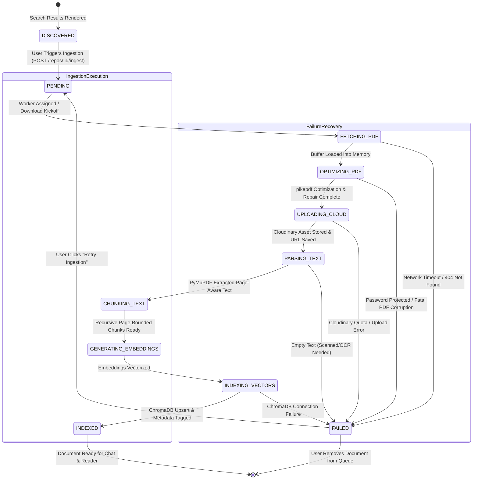
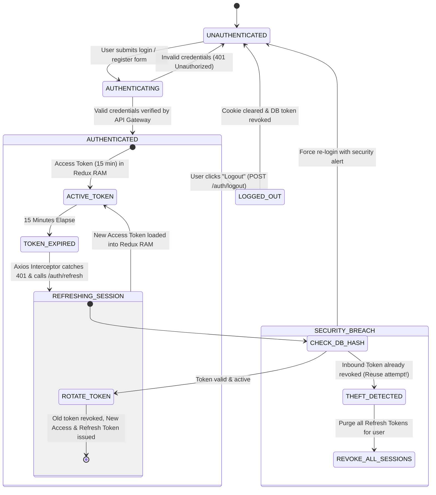
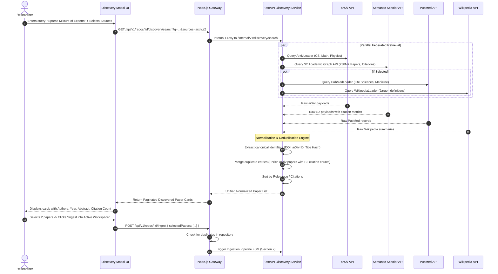
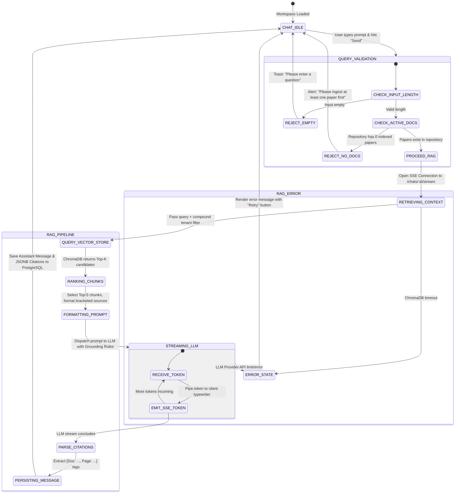
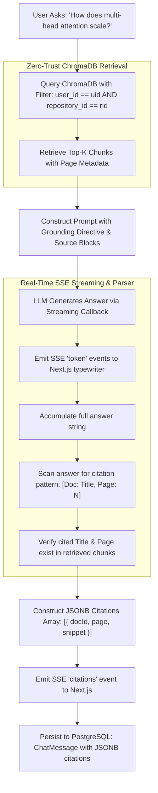
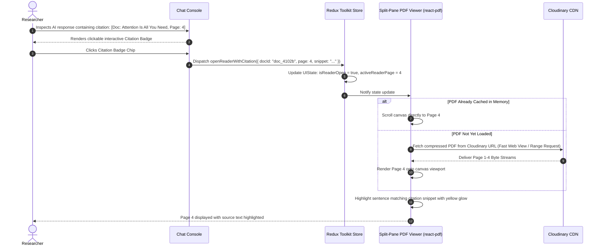
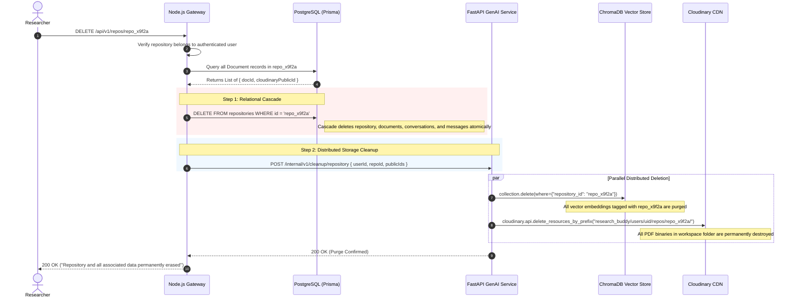

# Research Paper Synthesizer (ResearchBuddy)
## System Workflows, State Machines & Execution Lifecycle

*Document Identifier:* `WORKFLOW-SPEC-003`  
*Version:* `1.0.0`  
*Status:* Approved for Implementation  
*Scope:* Comprehensive System Workflows, Finite State Machines (FSMs), Event Triggers, Failure Recoveries, and Interaction Lifecycles  

---

## Table of Contents
1. [Workflow Architecture Overview](#1-workflow-architecture-overview)
2. [Document Ingestion & Processing Pipeline State Machine](#2-document-ingestion--processing-pipeline-state-machine)
3. [User Authentication & Session Lifecycle State Machine](#3-user-authentication--session-lifecycle-state-machine)
4. [Multi-Source Literature Discovery Workflow](#4-multi-source-literature-discovery-workflow)
5. [Conversational RAG & Grounded Synthesis State Machine](#5-conversational-rag--grounded-synthesis-state-machine)
6. [Interactive Split-Screen Reader & Citation Navigation Workflow](#6-interactive-split-screen-reader--citation-navigation-workflow)
7. [Repository Management & Cascade Deletion Workflow](#7-repository-management--cascade-deletion-workflow)
8. [Failure Recovery, Resiliency & Circuit Breakers](#8-failure-recovery-resiliency--circuit-breakers)

---

## 1. Workflow Architecture Overview

ResearchBuddy coordinates multiple asynchronous, stateful, and real-time operations across three service boundaries (Next.js Client, Node.js API Gateway, and Python FastAPI GenAI microservice). To maintain data consistency, multi-tenant isolation, and immediate user feedback, all operations follow deterministic **Finite State Machines (FSMs)**.

```
┌──────────────────────────────────────────────────────────────────────────────────┐
│                            CORE SYSTEM STATE MACHINES                            │
├──────────────────────┬──────────────────────┬────────────────────────────────────┤
│ 1. INGESTION FSM     │ 2. AUTHENTICATION    │ 3. CONVERSATIONAL RAG FSM          │
│ PENDING ──► OPTIMIZE │ UNAUTHENTICATED      │ IDLE ──► RETRIEVING ──► STREAMING  │
│    │           │     │       │              │             │              │       │
│    ▼           ▼     │       ▼              │             ▼              ▼       │
│ UPLOAD ───► INDEXED  │ AUTHENTICATED ──►RTR │      GROUNDED CITATIONS ──►STORED  │
└──────────────────────┴──────────────────────┴────────────────────────────────────┘
```

---

## 2. Document Ingestion & Processing Pipeline State Machine

The document ingestion pipeline coordinates PDF downloading, C++ structural repair and compression (`pikepdf`), cloud asset hosting (Cloudinary), text and layout extraction (PyMuPDF), semantic chunking, and vector indexing (ChromaDB).

### 2.1 Formal Finite State Machine (FSM)



### 2.2 State Transition Matrix & Actions

| Current State | Event / Trigger | Target State | Internal Actions & Emitted SSE Event | Failure / Fallback Transition |
| :--- | :--- | :--- | :--- | :--- |
| `DISCOVERED` | User checks paper & selects repository | `PENDING` | Creates `Document` row in PostgreSQL with `status: PENDING`. Generates `jobId`. | N/A |
| `PENDING` | FastAPI ingestion task claimed | `FETCHING_PDF` | Stream SSE: `{ step: "FETCHING_PDF", percent: 15 }`. Downloads binary buffer from external URL. | If download fails $\to$ `FAILED` |
| `FETCHING_PDF` | Binary stream in memory | `OPTIMIZING_PDF` | Stream SSE: `{ step: "OPTIMIZING_PDF", percent: 35 }`. Invokes `pikepdf` engine: linearizes, deflates object streams, repairs broken xref tables. | If password-locked or non-repairable $\to$ `FAILED` |
| `OPTIMIZING_PDF`| Optimization buffer produced | `UPLOADING_CLOUD`| Stream SSE: `{ step: "UPLOADING_CLOUD", percent: 55 }`. Streams buffer to Cloudinary signed folder `users/{uid}/repos/{rid}/`. Updates PostgreSQL with `cloudinaryUrl`. | If upload fails $\to$ `FAILED` |
| `UPLOADING_CLOUD`| Cloudinary returns secure URL | `PARSING_TEXT` | Stream SSE: `{ step: "PARSING_TEXT", percent: 70 }`. Opens stream in PyMuPDF (`fitz`). Extracts text per page preserving geometry and column order. | If text $< 50$ chars total $\to$ `FAILED` (OCR required) |
| `PARSING_TEXT` | Page dictionary created | `CHUNKING_TEXT` | Stream SSE: `{ step: "CHUNKING_TEXT", percent: 80 }`. Splits pages via `RecursiveCharacterTextSplitter` (1000 char size, 200 overlap). Enforces chunk-to-page boundary constraints. | If 0 chunks produced $\to$ `FAILED` |
| `CHUNKING_TEXT`| Chunks array formed | `GENERATING_EMBEDDINGS` | Stream SSE: `{ step: "GENERATING_EMBEDDINGS", percent: 90 }`. Batch generates vector embeddings (dense vectors). | If embedding API errors out $\to$ `FAILED` |
| `GENERATING_EMBEDDINGS`| Dense vectors created | `INDEXING_VECTORS` | Stream SSE: `{ step: "INDEXING_VECTORS", percent: 95 }`. Inserts records into ChromaDB collection `research_paper_embeddings` with tenant metadata tags. | If Chroma write fails $\to$ `FAILED` |
| `INDEXING_VECTORS`| ChromaDB write confirmed | `INDEXED` | Stream SSE: `{ step: "COMPLETE", percent: 100, status: "INDEXED" }`. Sets PostgreSQL `status: INDEXED`. Ready for RAG. | N/A |
| Any State | Exception thrown | `FAILED` | Sets PostgreSQL `status: FAILED`, writes `errorMessage`. Emits SSE: `{ step: "FAILED", error: "..." }`. | Enables manual "Retry" action |

---

## 3. User Authentication & Session Lifecycle State Machine

ResearchBuddy implements stateless dual-token authentication (short-lived Access Tokens held in client memory, long-lived Refresh Tokens stored in secure `HttpOnly` browser cookies).

### 3.1 Session Lifecycle FSM



### 3.2 Client HTTP Interceptor & Silent Refresh Algorithm
To ensure zero friction when the 15-minute access token expires during active research:

```mermaid
sequenceDiagram
    autonumber
    actor User as Researcher
    participant UI as Next.js Client (Axios Client)
    participant Gateway as Node.js Gateway
    participant DB as PostgreSQL

    User->>UI: Action: Open Repository Workspace
    UI->>Gateway: GET /api/v1/repos/repo_123 (Authorization: Bearer <Expired_Token>)
    Gateway-->>UI: 401 Unauthorized (Error: "TOKEN_EXPIRED")

    note over UI: Axios Response Interceptor Triggers
    UI->>UI: Queue original request into retryQueue
    UI->>Gateway: POST /api/v1/auth/refresh (Browser sends HttpOnly refreshToken cookie)
    
    Gateway->>DB: Verify token_hash in refresh_tokens table
    alt Valid Active Token
        Gateway->>DB: Invalidate current token (is_revoked = true)
        Gateway->>DB: Insert new token hash
        Gateway-->>UI: Set-Cookie: newRefreshToken; Body: { accessToken: <New_Token> }
        UI->>UI: Update Redux state with new accessToken
        UI->>Gateway: Replay queued request with new accessToken
        Gateway-->>UI: 200 OK with Repository Data
        UI-->>User: Seamlessly renders workspace (No re-login prompt)
    else Token Revoked / Reused (Theft Anomaly)
        Gateway->>DB: Invalidate ALL refresh tokens for this user
        Gateway-->>UI: Clear-Cookie; 403 Forbidden ("SESSION_COMPROMISED")
        UI->>UI: Wipe Redux auth slice & redirect to /login
        UI-->>User: Prompt: "Your session was terminated for security. Please sign in again."
    end
```

---

## 4. Multi-Source Literature Discovery Workflow

This workflow enables cross-disciplinary literature search across arXiv, Semantic Scholar, PubMed, and Wikipedia without polluting the vector database.

### 4.1 Federated Discovery Execution Flow



---

## 5. Conversational RAG & Grounded Synthesis State Machine

This state machine governs user Q&A interactions, ensuring that responses stream in real time and strictly cite verified source pages from documents in the current repository.

### 5.1 Conversational RAG Execution FSM



### 5.2 Citation Grounding & Parsing Pipeline



---

## 6. Interactive Split-Screen Reader & Citation Navigation Workflow

ResearchBuddy features a synchronous connection between the conversational chat interface and the built-in PDF reader.

### 6.1 Split-Screen Interaction Workflow



---

## 7. Repository Management & Cascade Deletion Workflow

When a user modifies or deletes a workspace repository, data integrity must be maintained across PostgreSQL, ChromaDB, and Cloudinary.

### 7.1 Cross-Storage Cascade Deletion Workflow



---

## 8. Failure Recovery, Resiliency & Circuit Breakers

To deliver enterprise-grade reliability, the platform implements specific recovery paths for every potential point of failure:

| Failure Scenario | Detection Mechanism | Immediate System Response | User Experience & Recovery Path |
| :--- | :--- | :--- | :--- |
| **External Academic API Outage (e.g., Semantic Scholar 503)** | HTTP status code $\ge 500$ or timeout ($> 8\text{s}$) in FastAPI adapter | Retry $3\times$ with exponential backoff (`tenacity`). Fall back to remaining online sources (arXiv, PubMed). | Discovery modal displays warning badge: *"Semantic Scholar unavailable; showing results from arXiv and PubMed."* |
| **Corrupted or Malformed PDF Binary** | `pikepdf.PdfError` during parsing or xref rebuild | Catch exception in `pike_optimizer.py`. Attempt fallback parse via raw PyMuPDF without optimization. | If PyMuPDF also fails, mark document `FAILED` with message *"PDF structure unreadable or corrupted."* User prompted to upload alternate copy. |
| **Scanned Document (No Text Layer)** | PyMuPDF extracts $< 50$ characters across initial 3 pages | Detect empty string threshold in `mupdf_extractor.py`. Abort vector chunking. | Document marked `FAILED` with message *"Scanned document detected. Optical Character Recognition (OCR) required."* |
| **Client Disconnection during Ingestion SSE** | Browser tab closed or network dropped mid-ingestion | Ingestion task continues execution in background on FastAPI server; progress updates commit to PostgreSQL. | When user re-opens workspace, client queries `GET /api/v1/repos/:id/documents` and sees document in its updated `INDEXED` state. |
| **Client Disconnection during RAG Token Stream** | Abrupt client TCP termination | Gateway detects closed socket and cancels internal stream to FastAPI; FastAPI cancels LLM stream. | Incomplete answer discarded; user can re-submit question upon reconnection. |
| **ChromaDB Connection Drop** | Vector store query timeout ($> 3000\text{ms}$) | Catch connection exception in `chroma_client.py`. Log critical alert. | Gateway emits SSE event: `event: error { message: "Search index temporarily unavailable. Please try again shortly." }`. |

---

## 9. Conclusion & Implementation Sign-off
This document defines the behavioral and state mechanics for ResearchBuddy. All client components (Redux reducers, UI hooks, reader controls), API Gateway controllers, and FastAPI microservice handlers must conform to the state transitions, payloads, and recovery pathways established in this specification.
